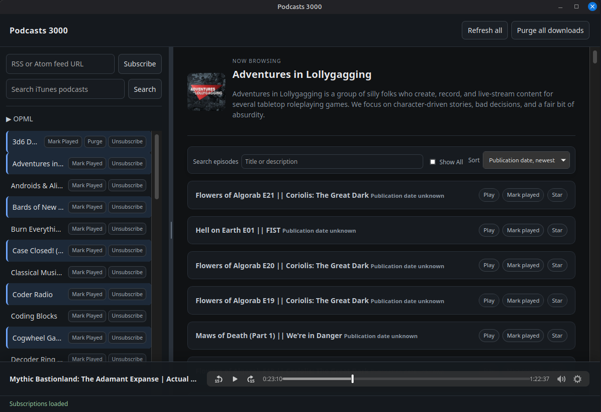

# Podcasts 3000

Minimal, offline-first podcast player built with Go, pure-Go SQLite, and vanilla HTML5.



## Run the desktop application

```sh
go run -tags 'production webkit2_41' ./cmd/podcasts3000
```

This launches the Wails desktop window. Data is stored under the platform user configuration directory. Set `PODCASTS3000_DATA_DIR` to choose another location.

Linux desktop builds require the WebKitGTK development/runtime libraries required by Wails. Windows builds use WebView2.

On Linux, the `production` and `webkit2_41` build tags are required. The repository includes WebKitGTK 4.1 support; verify it is installed with:

```sh
pkg-config --modversion webkit2gtk-4.1
```

If Go is not available in a new shell, enable the installed toolchain first:

```sh
export PATH=/usr/local/go/bin:$PATH
go version
```

The package path starts with `./` (a relative path), not `/.`:

```sh
./cmd/podcasts3000
```

`go run` uses a temporary executable and does not leave a binary in the repository. Use `make build` when a persistent `podcasts3000` binary is required. `make run-dev` is available for Wails development builds.

Use `make release` to create `release/podcasts3000-linux-amd64` and `release/podcasts3000-windows-amd64.exe`.
The Windows release is linked with the GUI subsystem, so launching it does not create a console window.

GitHub Actions runs the test, Wails-tagged runtime test, and vet targets on pushes and pull requests. Pushing a `v*` tag builds both release executables and publishes them to a GitHub release.

The Wails frontend source lives exclusively under `cmd/podcasts3000/frontend` and is embedded into the binary. The root `web/` directory is not used and may remain absent.

## Verify

```sh
go test ./...
go vet ./...
```

For a Wails-tagged integration compile and embedded-frontend smoke test:

```sh
make runtime-test
```

This validates the production Wails package, embedded assets, and the bound `podcasts.App` namespace. A full GUI interaction test still requires a graphical desktop session; manually verify subscribing with a reachable RSS feed after launching `make run`.

The backend is organized around `internal/podcasts.App` and is bound directly to the embedded Wails frontend. No Node toolchain is required.

## Disclaimer

This application was produced using AI (Gemini, Copilot).
